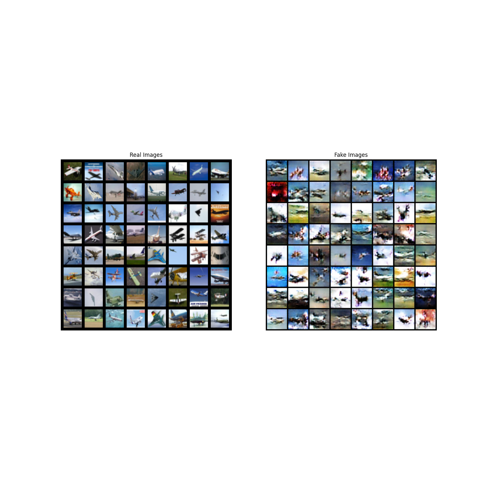
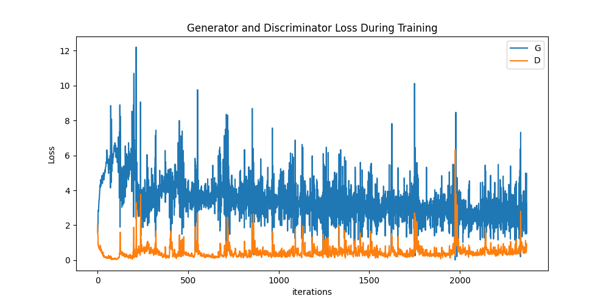

# DCGAN — CIFAR-10 Airplane Generation

PyTorch implementation of a Deep Convolutional
Generative Adversarial Network (DCGAN).

## Dataset
- CIFAR-10 (Airplane class)
- 6,000 images
- Image resolution: 32 x 32

## Training
- Epochs: 30
- Optimizer: Adam
- Architecture: DCGAN

## Results

### Generated Images

### Training Loss

## Observations
- The generator learned recognizable aircraft structures.
- Generated images contained visual artifacts.
- Generator and discriminator losses showed fluctuations.

## Future Work
- Explore diffusion-based generative models.
